<p align="center">
  
</p>

<h1 align="center">🌐 Awesome Real-Time Multilingual Support Orchestration 🚀</h1>

<p align="center">
  <strong>A curated directory of enterprise SaaS platforms, open-source AI translation pipelines, and LangOps architectures enabling global customer support teams to communicate across languages in real time.</strong>
</p>

<p align="center">
  <a href="https://github.com/ishandutta2007/Awesome-Awesome-Awesome"></a><a href="https://discord.gg/jc4xtF58Ve"></a>
  <a href="https://github.com/ishandutta2007/Awesome-Real-Time-Multilingual-Support-Orchestration/stargazers"></a>
  <a href="https://github.com/ishandutta2007/Awesome-Real-Time-Multilingual-Support-Orchestration/network/members"></a>
  <a href="https://github.com/ishandutta2007/Awesome-Real-Time-Multilingual-Support-Orchestration/issues"></a>
  <a href="https://github.com/ishandutta2007/Awesome-Real-Time-Multilingual-Support-Orchestration/blob/main/LICENSE"></a>
  <a href="https://github.com/ishandutta2007/Awesome-Real-Time-Multilingual-Support-Orchestration/pulls"></a>
  <a href="https://github.com/ishandutta2007"></a>
</p>

---

## 📌 Table of Contents

- [🔍 Overview & SEO Meta Summary](#-overview--seo-meta-summary)
- [📊 Sector Overview & Market Dynamics](#-sector-overview--market-dynamics)
- [🏢 Enterprise SaaS Platforms](#-enterprise-saas-platforms)
  - [SaaS Comparison Matrix](#saas-comparison-matrix)
  - [Platform Deep Dives](#platform-deep-dives)
- [🔓 Open-Source GitHub Projects](#-open-source-github-projects)
  - [Top Open-Source Projects (Ranked by Stars)](#top-open-source-projects-ranked-by-stars)
  - [Open-Source Architectural Ecosystem](#open-source-architectural-ecosystem)
- [🏗️ Orchestration Architectural Patterns](#️-orchestration-architectural-patterns)
- [🤝 How to Contribute](#-how-to-contribute)
- [☕ Support & Sponsorship](#-support--sponsorship)
- [⭐ Star History](#--star-history)
- [⚖️ Compliance & Disclaimer](#️-compliance--disclaimer)

---

## 🔍 Overview & SEO Meta Summary

This repository tracks the state-of-the-art in **Real-Time Multilingual Support Orchestration (LangOps)** across commercial enterprise SaaS platforms and self-hosted open-source technologies. 

Serving global customers without hiring regional multilingual call centers requires automated real-time translation pipelines integrated directly into existing helpdesk CRMs (such as **Zendesk, Salesforce Service Cloud, Dixa, Intercom, Freshdesk, and ServiceNow**), omni-channel messaging apps (**WhatsApp, Instagram DM, SMS**), and contact center telephony (**Genesys, Cisco, NICE, Twilio**).

### 🎯 Key Focus Areas & Keywords
- **Real-Time Chat & Voice Translation**: Sub-second text-to-text (MT) and millisecond speech-to-speech (STT → MT → TTS) pipelines.
- **Glossary & Brand Terminology Enforcement**: Preventing neural hallucination of trademarked names, SKU numbers, and industry jargon.
- **Enterprise Data Sovereignty & PII Redaction**: Zero-trace compliance, GDPR/SOC 2 certifications, and air-gapped self-hosted translation.
- **Hybrid Human-in-the-Loop (HITL)**: Automated translation quality scoring (TQI) with instant routing to bilingual linguists for high-stakes tickets.
- **Multilingual RAG & Agentic Support**: Code-switching detection (e.g., Hinglish, Spanglish), hybrid retrieval-augmented generation, and deterministic evaluation gates.

---

## 📊 Sector Overview & Market Dynamics

The global language services and localization software market is estimated at **$72.0 Billion to $81.5 Billion**, with the dedicated AI Machine Translation (MT) and real-time customer service translation sub-sector expanding at an aggressive **15% to 22.1% CAGR** toward **$4.0+ Billion**.

### 🧩 Market Fragmentation Analysis
The real-time multilingual support orchestration sector is **moderately to highly fragmented** rather than a winner-take-all monopoly:
- **Core AI Translation Layer**: Moderately concentrated among foundational frontier model developers and specialized MT providers (DeepL, Google Cloud Translation, Microsoft Azure Translator, ModernMT).
- **Orchestration & Workflow Layer**: Highly fragmented across CRM-specific middleware, Contact Center as a Service (CCaaS) telephony connectors, and specialized B2B LangOps vendors catering to distinct compliance regimes (FINRA, HIPAA, GDPR).
- **Self-Hosted & Open-Source Emergence**: High privacy demands and recurring enterprise character-based pricing have driven widespread adoption of self-hosted open-source pipelines (Whisper, faster-whisper, LibreTranslate, Argos, and Chatwoot) for full on-premise data control.

---

## 🏢 Enterprise SaaS Platforms

Below is the comparative breakdown of industry-leading SaaS platforms providing real-time multilingual customer support, sorted descending by company scale (valuation and annual recurring revenue).

### SaaS Comparison Matrix

| Product | Company Size (Valuation / Revenue) | Starting Tier Pricing | Free Tier / Free Trial Limits | Key Specialization & CRM Integrations |
| :--- | :--- | :--- | :--- | :--- |
| **[DeepL](#deepl)** | **~$2.0B Valuation**<br>*(Series C 2024, ~€300M ARR)* | **$29.75 / month**<br>*($23.80/mo billed annually on API Growth)* | **Developer API: 1,000,000 characters total lifetime quota**; web translation free up to 1,500 chars/query | Real-time neural MT, DeepL Voice API for contact center calls, sub-second translation latency |
| **[Smartling](#smartling)** | **~$250M+ Valuation**<br>*(Vitruvian Partners PE; ~$55M–$60M ARR)* | **$200 / month**<br>*(Starter translation package or ~$2,400/yr)* | **Free-to-Start plan** for basic document translation with limited TM; assisted enterprise pilot demo | Salesforce Service Cloud & Intercom native connectors, automated ticket & chat translation, brand glossaries |
| **[Unbabel](#unbabel)** | **~$91.2M Funding**<br>*(Acquired by TransPerfect 2025; ~$50M–$85M ARR)* | **$10,000 / year**<br>*(~$833/mo minimum commitment for Starter)* | **No permanent free plan**; 14-day customized proof-of-concept sandbox upon qualification | Hybrid LangOps (AI MT + human editors), Zendesk messaging & Salesforce Service Cloud integrations |
| **[Phrase](#phrase)** | **Carlyle PE Backed**<br>*(Acquired Memsource/Phrase; ~$45M–$60M ARR)* | **$27 / seat / month**<br>*(Strings Starter) or $1,000+/mo (Team)* | **14-day free trial** with full platform capabilities, no credit card required | Speed API (~1s latency), 800+ language pairs, automated MT engine routing, Zendesk/Salesforce apps |
| **[Lokalise](#lokalise)** | **$56M Funding**<br>*(Series B, CRV; ~$25M–$35M ARR)* | **$144 / month**<br>*($120/mo billed annually on Explorer)* | **14-day free trial** unlocking full Enterprise capabilities without credit card requirement | Lokalise Messages for Dixa & HubSpot Inbox, two-way live chat MT, zero-storage message privacy |
| **[Translated (ModernMT)](#translated-modernmt)** | **$30M Funding**<br>*(Ardian 2021; ~$30M–$50M Rev)* | **$15 per 1M characters**<br>*(ModernMT API) or $25/mo freelance* | **Matecat web platform is 100% free forever**; ModernMT provides a **30-day free trial** | Context-adaptive neural machine translation, Matecat collaborative CAT tool, terminology memory |
| **[Weglot](#weglot)** | **€45M Growth Round**<br>*(Partech 2022; ~€15M–$25M ARR)* | **€15 / month**<br>*(~$16/mo for Starter tier, 10k words)* | **Free forever plan: 2,000 words, 1 target language, 1 website**; 14-day free trial on higher tiers | Automated website and Zendesk Help Center translation, continuous sync, multilingual SEO |
| **[Crowdin](#crowdin)** | **Bootstrapped**<br>*(Profitable, ~$13M–$14M ARR)* | **$59 / month**<br>*($49/mo billed annually on Pro plan)* | **Free forever plan: 1 private project, unlimited public repos, 60k words**; 14-day Team trial | Zendesk, Freshdesk, Intercom, and Help Scout connectors; format-safe workflows preserving HTML/macros |
| **[Language I/O](#language-io)** | **$12.1M Funding**<br>*(Omega Venture Partners; ~$6.3M ARR)* | **$10,000 / year**<br>*(~$833/mo for Pilot Tier 1)* | **No permanent free plan**; 30-day sandbox pilot/evaluation period available upon sales review | Telephony voice translation (Genesys, NICE, Cisco), zero-trace data compliance, Salesforce/Zendesk chat |
| **[Transifex](#transifex)** | **Acquired by XTM**<br>*(Jan 2025; ~$5M–$10M ARR)* | **$160 / month**<br>*($135/mo billed annually on Starter)* | **15-day free trial** (unlimited features, no credit card); **100% free tier for open-source projects** | Translation Quality Index (TQI) automated scoring, Zendesk tickets/chat, PII redaction & GDPR/SOC 2 |

---

### Platform Deep Dives

#### DeepL
- **Live Translation Focus**: Real-time neural machine translation renowned for linguistic nuance and fluency.
- **Voice API (Contact Center)**: Launched in 2025, providing live transcription and translation during phone conversations, empowering any support agent to handle calls in foreign languages without bilingual transfers.
- **Enterprise Features**: Zero-data retention agreements, glossary enforcement, and native enterprise REST APIs.

#### Smartling
- **Live Translation Focus**: Enterprise-grade translation management with automated connectors for Salesforce Service Cloud and Intercom Help Center.
- **Workflow Automation**: Auto-translates inbound customer inquiries and outbound responses with brand glossary locking.
- **Help Center Sync**: Bidirectionally synchronizes Intercom and Salesforce Knowledge articles without manual file export.

#### Unbabel
- **Live Translation Focus**: AI-powered LangOps combining instant neural translation with a distributed network of freelance human post-editors for higher-tier ticket escalation.
- **Omnichannel Support**: Plugs into Zendesk messaging across WhatsApp, Instagram DM, Twitter/X, and Web Chat with a 4,000-character thread capacity.
- **Quality Reporting**: Granular translation confidence metrics and automated escalations based on customer sentiment.

#### Phrase
- **Live Translation Focus**: Unified platform combining Phrase Strings and Phrase TMS (formerly Memsource).
- **Speed API**: Delivers ~1-second translation response times suited for high-throughput live chat windows.
- **Multi-Engine Routing**: Dynamically chooses between DeepL, Google Translate, and custom-trained MT models depending on the language pair and quality history.

#### Lokalise Messages
- **Live Translation Focus**: Native live chat translation built specifically for customer success agents on Dixa and HubSpot Inbox.
- **Agent Workflow**: Support reps draft messages in their native language or prefix internal notes with `!` to trigger customer-facing translation.
- **Data Protection**: Strict zero-trace architecture where customer messages are never stored on translation servers.

#### Translated (ModernMT)
- **Live Translation Focus**: Patented context-aware machine translation that continuously learns from user corrections and enterprise translation memories in real time.
- **Matecat Integration**: Connects with Matecat's web-based collaborative translation environment for human-in-the-loop review.

#### Weglot
- **Live Translation Focus**: Seamless JavaScript-based translation layer designed for customer help centers and knowledge bases.
- **Zendesk Help Center Integration**: Translates support articles into 100+ languages with automatic hreflang tagging and multilingual SEO indexing.

#### Crowdin
- **Live Translation Focus**: Localization and continuous delivery platform supporting Zendesk, Freshdesk, Intercom, and docs-as-code Git repos.
- **Formatting Preservation**: Guarantees that code snippets, liquid tags, macros, and HTML layouts remain intact during automatic translation.

#### Language I/O
- **Live Translation Focus**: Voice and omni-channel customer support translation engineered for contact centers.
- **Telephony Pipeline**: Real-time speech-to-text → glossary-enforced translation → text-to-speech for Genesys, NICE inContact, and Cisco systems.
- **Zero-Trace Architecture**: ISO 27001 and SOC 2 Type II certified; PII is scrubbed before passing through translation models.

#### Transifex
- **Live Translation Focus**: Continuous localization management with dedicated Zendesk Guide and Zendesk Support integrations.
- **Translation Quality Index (TQI)**: Machine learning model assessing translation fluency and context in real time, auto-publishing high-confidence strings while flagging edge cases.

---

## 🔓 Open-Source GitHub Projects

For organizations prioritizing complete data sovereignty, HIPAA/FINRA compliance, or bypassing recurring per-character enterprise API costs, these open-source projects form a modular, self-hostable multilingual support orchestration stack.

### Top Open-Source Projects (Ranked by Stars)

1. **[OpenAI Whisper](https://github.com/openai/whisper)** [](https://github.com/openai/whisper/stargazers)  
   *General-purpose speech recognition and translation model trained on 680,000 hours of multilingual data. The foundation for real-time multilingual voice support agents and phone audio transcription.*

2. **[Flowise](https://github.com/FlowiseAI/Flowise)** [](https://github.com/FlowiseAI/Flowise/stargazers)  
   *Drag-and-drop visual UI for building LLM orchestration pipelines. Allows support engineers to visually chain translation models, glossary validation nodes, CRM lookups, and customer reply agents.*

3. **[Coqui TTS](https://github.com/coqui-ai/TTS)** [](https://github.com/coqui-ai/TTS/stargazers)  
   *Deep learning toolkit for Text-to-Speech in 1,100+ languages with voice cloning. Generates natural-sounding synthesized speech responses for voice-based multilingual helpdesk phone bots.*

4. **[Chatwoot](https://github.com/chatwoot/chatwoot)** [](https://github.com/chatwoot/chatwoot/stargazers)  
   *Open-source omnichannel customer support platform (open alternative to Intercom & Zendesk) featuring live website chat, email ticketing, WhatsApp/Telegram channels, and webhook-driven translation bot hooks.*

5. **[faster-whisper](https://github.com/SYSTRAN/faster-whisper)** [](https://github.com/SYSTRAN/faster-whisper/stargazers)  
   *Optimized reimplementation of OpenAI's Whisper using CTranslate2. Delivers up to 4x faster inference with reduced GPU VRAM consumption, essential for low-latency live telephony support.*

6. **[LibreTranslate](https://github.com/LibreTranslate/LibreTranslate)** [](https://github.com/LibreTranslate/LibreTranslate/stargazers)  
   *Free, self-hostable machine translation REST API supporting 50+ languages with zero API key dependencies or usage billing. Built on top of Argos Translate with Docker/Kubernetes readiness.*

7. **[Seamless Communication (SeamlessM4T)](https://github.com/facebookresearch/seamless_communication)** [](https://github.com/facebookresearch/seamless_communication/stargazers)  
   *Meta AI’s foundational multilingual and multimodal AI translation model. Powers expressive, real-time speech-to-speech, speech-to-text, and text-to-speech translation across nearly 100 languages.*

8. **[OpenNMT-py](https://github.com/OpenNMT/OpenNMT-py)** [](https://github.com/OpenNMT/OpenNMT-py/stargazers)  
   *Open-source neural machine translation framework written in PyTorch. Used by research teams and enterprises to train custom translation models fine-tuned on proprietary company support logs.*

9. **[Argos Translate](https://github.com/argosopentech/argos-translate)** [](https://github.com/argosopentech/argos-translate/stargazers)  
   *Offline translation Python library and CLI based on OpenNMT. Runs on-premises without internet access, making it the top choice for air-gapped, sovereign support desk deployments.*

10. **[Weblate](https://github.com/WeblateOrg/weblate)** [](https://github.com/WeblateOrg/weblate/stargazers)  
    *Web-based continuous localization platform with tight version control (Git/GitHub/GitLab) integration. Manages helpdesk articles, canned replies, and knowledge base files with automated QA checks.*

11. **[Zammad](https://github.com/zammad/zammad)** [](https://github.com/zammad/zammad/stargazers)  
    *Open-source helpdesk and customer ticketing system with native multi-language UI, multilingual macro routing, and a flexible API architecture for attaching self-hosted MT translation engines.*

12. **[Tolgee](https://github.com/tolgee/tolgee-platform)** [](https://github.com/tolgee/tolgee-platform/stargazers)  
    *Developer-friendly web localization platform featuring in-context translation, translation memory management, and out-of-the-box integration with deep-learning machine translation APIs.*

13. **[Live Helper Chat](https://github.com/livehelperchat/livehelperchat)** [](https://github.com/livehelperchat/livehelperchat/stargazers)  
    *Self-hosted live support chat system featuring automated two-way translation extensions (compatible with LibreTranslate, Google Translate, and DeepL) for real-time web support.*

14. **[Matecat](https://github.com/matecat/MateCat)** [](https://github.com/matecat/MateCat/stargazers)  
    *Open-source Computer-Assisted Translation (CAT) tool backed by Translated. Provides collaborative post-editing, split-file workflows, and translation memory management for enterprise support teams.*

15. **[VaaniDesk](https://github.com/miransec/vaanidesk)** [](https://github.com/miransec/vaanidesk/stargazers)  
    *Multilingual AI customer support platform built end-to-end with controlled agents, hybrid RAG, and Hinglish/code-switching detection across English, Hindi, and Marathi with 113 deterministic evaluation gates.*

16. **[Chataptor](https://github.com/chataptor/chataptor-flutter)** [](https://github.com/chataptor/chataptor-flutter/stargazers)  
    *Headless Dart and Flutter client library for real-time auto-translated customer support chat across 100+ languages over Phoenix WebSockets, compatible with iOS, Android, Web, and Desktop.*

---

### Open-Source Architectural Ecosystem

Combine these components to construct a full-stack, zero-license-cost multilingual helpdesk:

```
[Customer Chat / Phone]
          │
          ▼
   [faster-whisper] ────► (Voice Stream Transcription < 200ms)
          │
          ▼
   [LibreTranslate / OpenNMT] ────► (Glossary & NER Terminology Lock)
          │
          ▼
   [Chatwoot / Zammad] ────► (Omnichannel Ticketing & Agent Desktop)
          │
          ▼
   [Coqui TTS] ────► (Natural Voice Synthesis for Audio Replies)
```

---

## 🏗️ Orchestration Architectural Patterns

When architecting a real-time multilingual customer support system, consider these core engineering patterns:

1. **Bidirectional WebSocket Interception**  
   Injecting a translation middleware between the customer socket and agent socket. Inbound messages are translated into the agent's preferred language; agent responses are translated back to customer locale prior to frame delivery.
2. **Named Entity Recognition (NER) & Glossary Masking**  
   Before dispatching text to an MT engine or LLM, regex and NER extract brand names, account numbers, and terms found in an enterprise glossary, replacing them with immutable tokens (e.g., `__GLOSSARY_ITEM_04__`) to preserve terminology integrity.
3. **Optimistic UI Updates with Post-Edit Escalation**  
   Displaying machine translation immediately with a confidence score. If the score falls below an acceptable threshold (e.g., TQI < 80), the system asynchronously routes the interaction to a bilingual triage specialist.
4. **Data Redaction & Zero-Trace Compliance**  
   Scrubbing PII (credit cards, addresses, phone numbers) at the edge before sending text payloads to external translation APIs to comply with GDPR, HIPAA, and CCPA standards.

---

## 🤝 How to Contribute

Contributions from support engineers, localization experts, and developers are welcome!

1. 🍴 **Fork the repository** on GitHub.
2. 🌿 **Create a new branch** (`git checkout -b feature/add-new-tool`).
3. 📝 **Add your tool or platform** to the appropriate section in `README.md`:
   - Follow the established table formatting for SaaS platforms (accurate starting price and free tier limits required).
   - For open-source projects, include the social star badge format:  
     `[](https://github.com/<owner>/<repo>/stargazers)`
   - Keep descriptions objective, factual, and focused on real-time multilingual support orchestration.
4. 🚀 **Submit a Pull Request** with a concise explanation of why the tool should be added.

---

## ☕ Support & Sponsorship

Thank you for exploring and utilizing the **Awesome Real-Time Multilingual Support Orchestration** ecosystem! 

If this repository has helped your team architect real-time translation pipelines, evaluate localization SaaS vendors, or build open-source customer support tooling, please consider supporting the project:

- ⭐ **Star this repository** to improve discoverability for other developers and support leaders.
- 🍴 **Fork and contribute** your tools, architectural patterns, and benchmarks.
- 📢 **Share** with your network across Discord, LinkedIn, and Twitter/X.
- ☕ **Sponsor the Maintainer**: Support ongoing curation, benchmark updates, and open-source tooling by buying a coffee at the [Sponsor Dashboard](https://github.com/sponsors/ishandutta2007).

---

##  Star History

[](https://star-history.dera.page/#ishandutta2007/Awesome-Real-Time-Multilingual-Support-Orchestration&type=date&legend=top-left)

---

## ⚖️ Compliance & Disclaimer

- **Community Curated**: This repository is a community-driven curated directory — listings are for informational and benchmarking purposes and do not constitute commercial endorsement.
- **Regulatory Compliance**: Multilingual support orchestration tools processing customer conversations must comply with data protection regulations (**GDPR, CCPA, HIPAA, SOC 2**), telephony call recording consent statutes, and regional cross-border data transfer laws.
- **Machine Translation Limitations**: Neural machine translation quality varies across low-resource language pairs, colloquial dialects, and sentiment-heavy interactions. High-stakes communication (medical, legal, financial) should always implement human-in-the-loop review.
- **Open-Source Hardening**: Self-hosted open-source software requires dedicated infrastructure hardening, model updates, and regular vulnerability scanning prior to handling production customer data.

---

<p align="center">
  <sub>Curated with ❤️ by <a href="https://github.com/ishandutta2007">Ishan Dutta</a> and the global open-source community.</sub>
</p>
